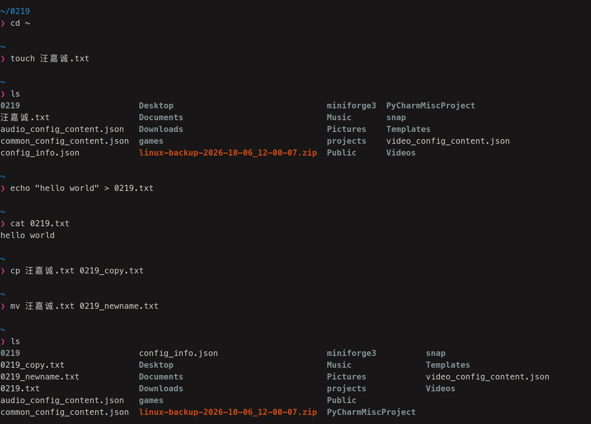
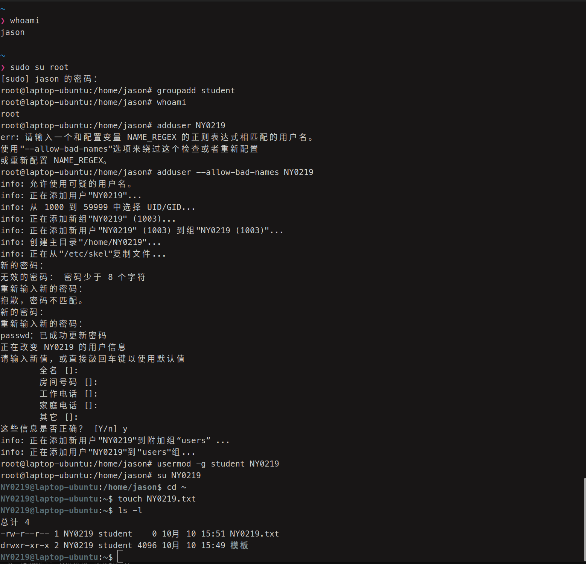
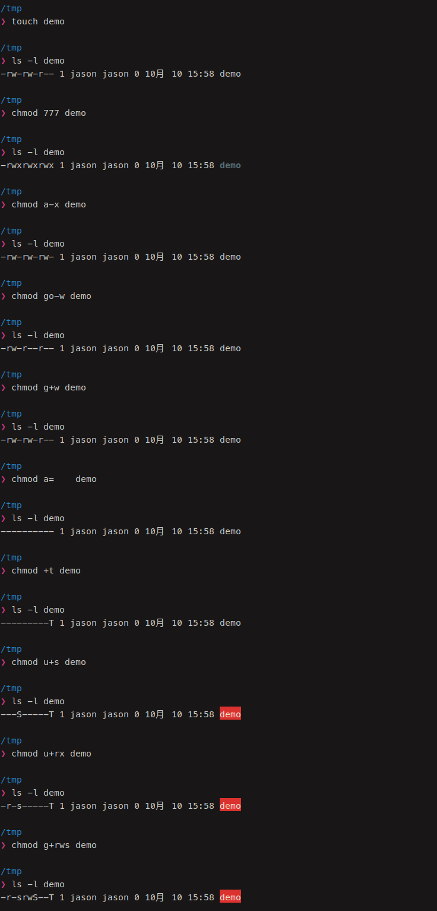
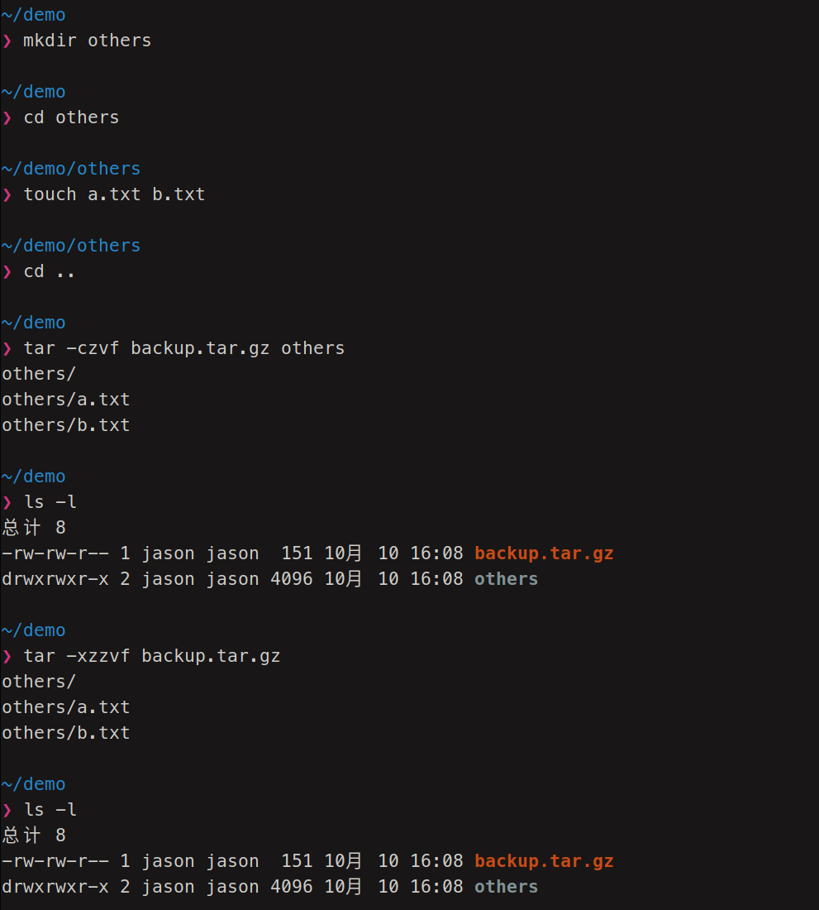
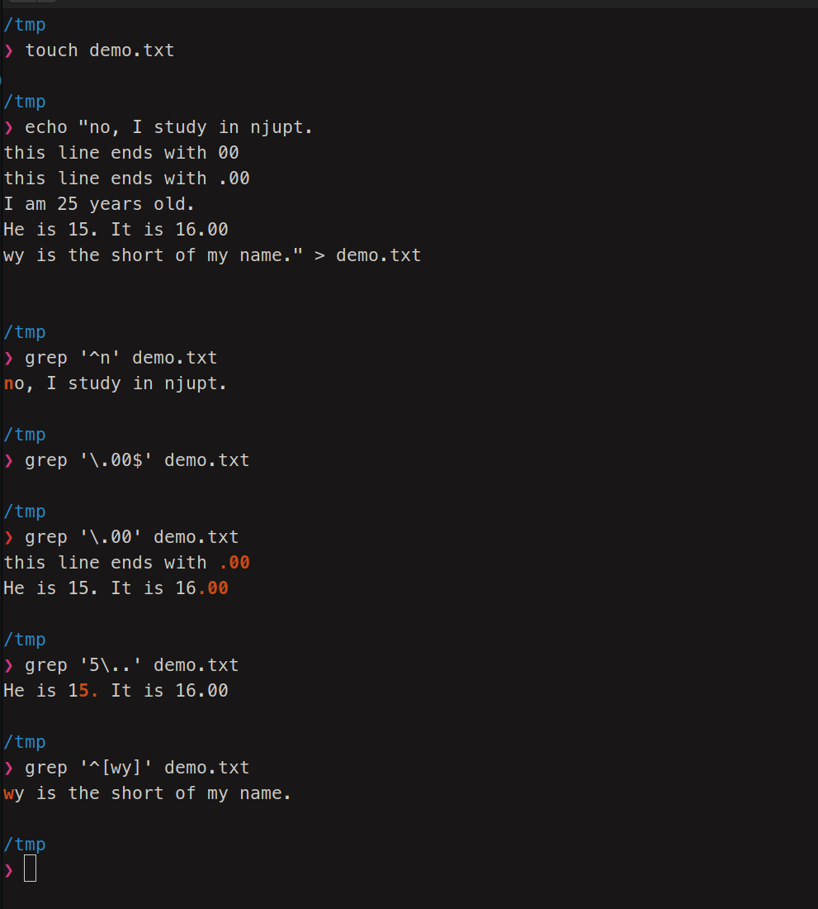
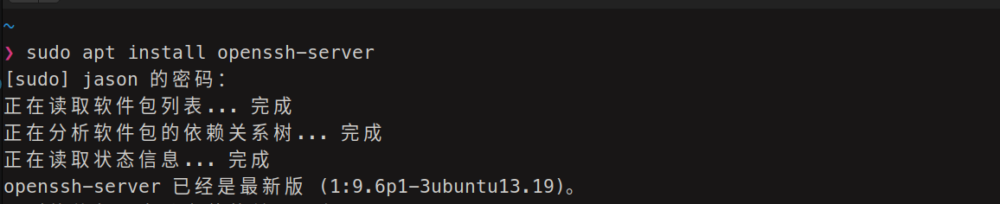
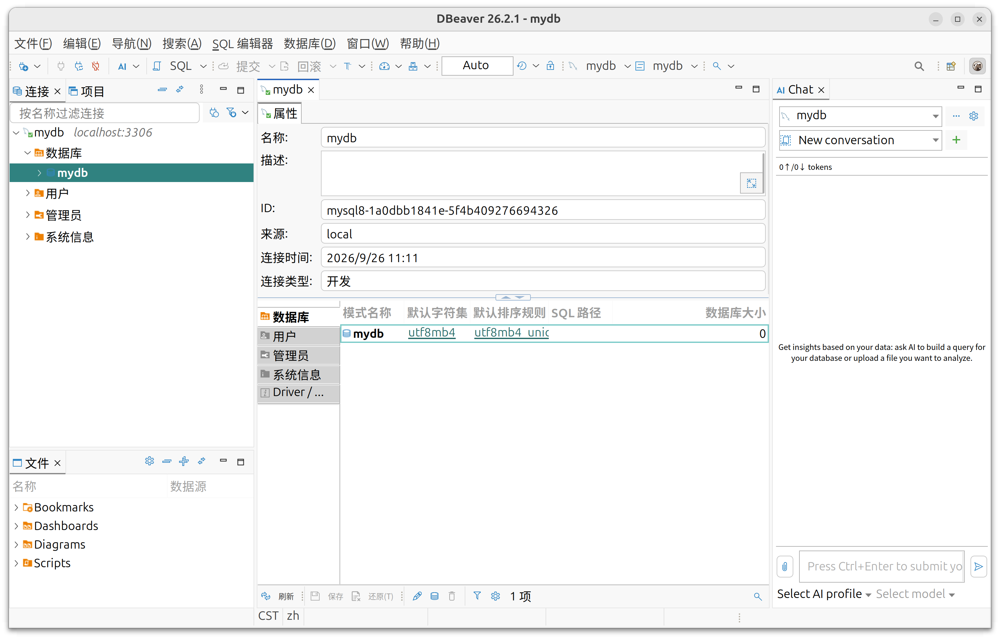

# Experiment 1

## (1) Directory Operation 
 

## (2) File operation 
 

## (3)User Management 
 

## (4) Permission management 
 

## (5) Other management 
 



# assignments in lecture: 

## 任务要求1：
使用openssh-server连接虚拟机并完成基本命令操作 

但我使用的是物理机，可以直接打开终端，安装openssh-server结果如下，可见之前就已经安装过了 



后续如下： 

```shell
jason@laptop-ubuntu /tmp/demo > pwd
/tmp/demo
jason@laptop-ubuntu /tmp/demo > ls
jason@laptop-ubuntu /tmp/demo > mkdir njupt
jason@laptop-ubuntu /tmp/demo > cd njupt
jason@laptop-ubuntu /tmp/demo/njupt > touch hello.txt
jason@laptop-ubuntu /tmp/demo/njupt > ls
hello.txt
jason@laptop-ubuntu /tmp/demo/njupt > echo "I love njupt" > hello.txt
jason@laptop-ubuntu /tmp/demo/njupt > cat hello.txt
I love njupt
jason@laptop-ubuntu /tmp/demo/njupt >
```
 

放在/tmp了因为不想污染目录 

## 任务要求2：
搭建 nginx 服务器，允许远程访问 

```shell
$  sudo su root 
root@laptop-ubuntu:/home/jason/projects/linux2026/B24060219汪嘉诚# cd /var/www/html/ 
root@laptop-ubuntu:/var/www/html# ls 
index.nginx-debian.html 
root@laptop-ubuntu:/var/www/html# vim index.html 
```


因为是物理机所以是localhost 

## 任务要求3： 
创建mysql服务器 

```sql
mysql> CREATE DATABASE mydb CHARACTER SET utf8mb4 COLLATE utf8mb4_unicode_ci;
Query OK, 1 row affected (0.01 sec)
mysql> CREATE USER 'myuser'@'localhost' IDENTIFIED BY '111111';
Query OK, 0 rows affected (0.02 sec)
mysql> GRANT ALL PRIVILEGES ON mydb.* TO 'myuser'@'localhost';
Query OK, 0 rows affected (0.01 sec)
mysql> FLUSH PRIVILEGES;
Query OK, 0 rows affected (0.00 sec)
mysql> SHOW DATABASES;
+--------------------+
| Database           |
+--------------------+
| information_schema |
| mydb               |
| mysql              |
| performance_schema |
| sys                |
+--------------------+
5 rows in set (0.00 sec)

mysql> exit
Bye
```
最后使用dbeaver-ce 连接数据库，效果如图 
